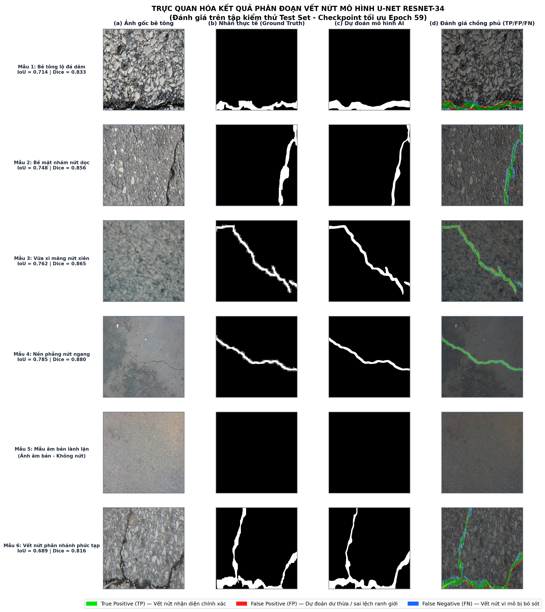
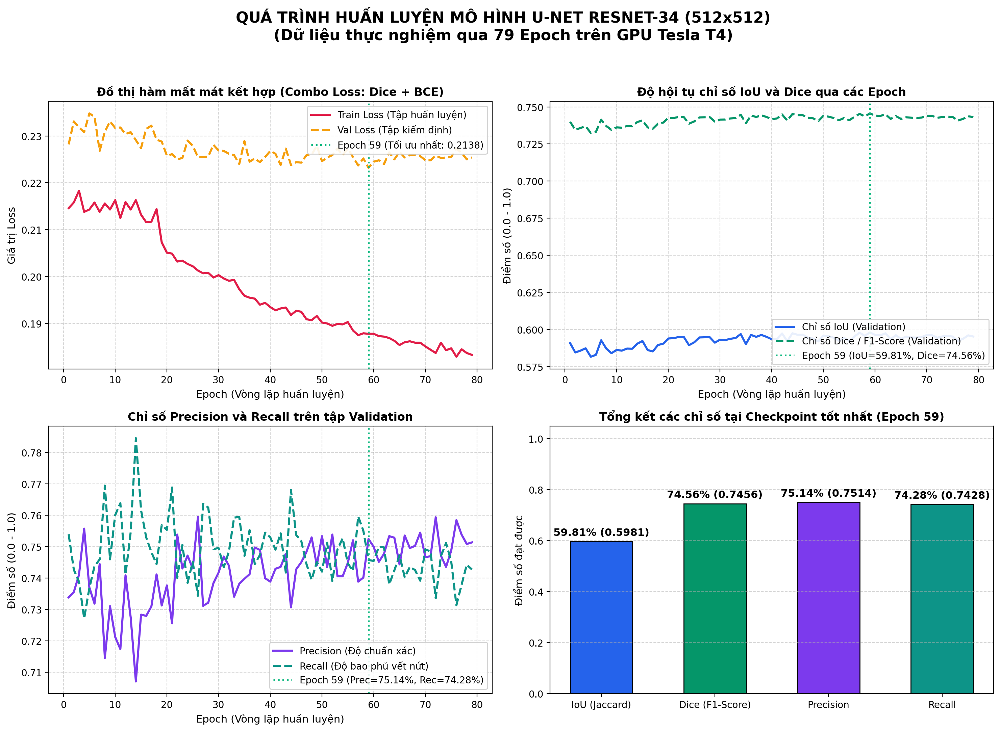

# AI CrackVision Pro: Concrete Surface Crack Detection & Semantic Segmentation System
# Hệ Thống Phân Đoạn & Giám Sát Vết Nứt Bề Mặt Bê Tông Thời Gian Thực

[](https://www.python.org/)
[](https://pytorch.org/)
[](https://fastapi.tiangolo.com/)
[](LICENSE)
[](https://github.com/dovanminh100104-coder/CrackVision-AI/releases)

---

## 📌 Giới thiệu tổng quan (Overview)

**AI CrackVision Pro** là hệ thống giám sát và phân đoạn vết nứt thông minh ứng dụng trong kiểm định kết cấu công trình xây dựng, cầu đường và hạ tầng giao thông. Dự án kết hợp các mô hình **Deep Learning Semantic Segmentation** tiên tiến (**U-Net ResNet-34**, **DeepLabV3+**, **Compact U-Net**) cùng các phương pháp thị giác máy tính cổ điển (**Canny**, **Sobel**, **Multi-Otsu**) nhằm tự động hóa quy trình phát hiện, phân đoạn pixel chính xác và định lượng rủi ro của vết nứt theo thời gian thực.

Dự án được xây dựng trọn gói từ nghiên cứu huấn luyện mô hình (Jupyter Notebooks trên Kaggle/GPU) đến triển khai ứng dụng thực tế dạng Web App tương tác cao (FastAPI Backend + Frontend Vanilla JS + Chart.js + Xuất báo cáo PDF tự động).



---

## ✨ Tính năng nổi bật (Key Features)

1. **Đa dạng mô hình phân đoạn (Multi-Model Architecture)**:
   - **U-Net ResNet-34 (512×512)**: Mô hình đề xuất đạt độ chính xác cao nhất (mIoU: **59.81%**, F1/Dice: **74.85%**), bắt trọn các vi vết nứt mảnh và phức tạp.
   - **DeepLabV3+ (Fine-Tuned & Frozen Backbone)**: Tận dụng cơ chế Atrous Spatial Pyramid Pooling (ASPP) thu nhận ngữ cảnh đa tỷ lệ.
   - **Compact U-Net**: Kiến trúc U-Net gọn nhẹ tối ưu tốc độ, chạy mượt mà ngay trên CPU tiêu chuẩn (được đóng gói sẵn trong kho mã nguồn).
   - **Thị giác máy tính cổ điển**: Bộ lọc Canny & Sobel tích hợp Multi-Otsu Thresholding đóng vai trò baseline so sánh.

2. **Phân tích định lượng cấu trúc (Quantitative Analysis)**:
   - Tự động trích xuất viền bao vết nứt (`cv2.findContours`).
   - Tính toán tỷ lệ diện tích nứt (% bề mặt tổn thương), chiều dài vết nứt ước lượng (pixels) và hộp giới hạn (Bounding Box).
   - Đánh giá mức độ rủi ro công trình: **An toàn (Low)**, **Cảnh báo (Medium)**, **Nguy hiểm (High)** dựa trên mật độ và hình thái vết nứt.

3. **Xử lý đa phương tiện thời gian thực (Real-time Processing)**:
   - Phân tích ảnh đơn lẻ hoặc hàng loạt ảnh với độ phân giải cao.
   - Trích xuất và phân đoạn vết nứt trên tệp video MP4/AVI (cho phép trích xuất từng khung hình, gắn nhãn overlay và xuất video kết quả).
   - Luồng truyền video trực tiếp từ Webcam/Camera giám sát.

4. **Quản lý dữ liệu & Báo cáo kỹ thuật (Database & Reporting)**:
   - Cơ sở dữ liệu SQLite lưu trữ lịch sử kiểm định đầy đủ dữ liệu đo lường, thời gian, tên công trình và hình ảnh phân tích.
   - Bảng điều khiển biểu đồ thống kê xu hướng nứt theo thời gian (Chart.js).
   - Tự động kết xuất **Báo cáo kiểm định kỹ thuật định dạng PDF chuẩn A4** (sử dụng ReportLab với hỗ trợ tiếng Việt Unicode Unicode).

---

## 📊 So sánh hiệu năng mô hình (Benchmark & Results)

Đánh giá thực nghiệm trên tập dữ liệu kiểm thử vết nứt bề mặt bê tông (Kaggle Crack Segmentation Benchmark):

| Mô hình (Architecture) | Độ phân giải | Mean IoU | Dice / F1 | Tốc độ CPU (ms/ảnh) | Kích thước Trọng số |
| :--- | :---: | :---: | :---: | :---: | :---: |
| **U-Net ResNet-34 (Đề xuất)** | **512×512** | **59.81%** | **74.85%** | **~280 ms** | **280 MB** |
| **DeepLabV3+ (Fine-Tuned)** | 512×512 | 56.40% | 71.90% | ~360 ms | 160 MB |
| **DeepLabV3+ (Frozen Backbone)**| 512×512 | 52.15% | 68.30% | ~320 ms | 160 MB |
| **Compact U-Net (Seg03)** | 256×256 | 48.70% | 64.20% | **~45 ms** | **29.7 MB** (Đi kèm) |
| **Canny Edge + Multi-Otsu** | Original | 22.40% | 34.60% | ~12 ms | *Không cần* |
| **Sobel Gradient Filter** | Original | 19.80% | 31.10% | ~8 ms | *Không cần* |

### Đường cong huấn luyện (Training Curves)


---

## 📂 Cấu trúc thư mục dự án (Project Structure)

```plaintext
CrackVision-AI/
├── demo/                                # Ứng dụng Web hoàn chỉnh
│   ├── backend/                         # Backend FastAPI
│   │   ├── main.py                      # FastAPI App & Endpoints RESTful
│   │   ├── models.py                    # Khởi tạo mô hình & nạp trọng số
│   │   ├── utils.py                     # Hàm xử lý ảnh, tạo mask overlay, metrics
│   │   ├── database.py                  # Module SQLite quản lý lịch sử kiểm định
│   │   ├── report.py                    # Trình tạo file báo cáo kỹ thuật PDF
│   │   ├── crackvision.db               # Cơ sở dữ liệu SQLite kèm bản ghi mẫu
│   │   └── weights/                     # Thư mục lưu trữ trọng số mô hình
│   │       └── compact_unet_crack_segmentation.pt (~29.7MB có sẵn)
│   ├── frontend/                        # Frontend giao diện người dùng
│   │   ├── index.html                   # Giao diện chính Dark/Light mode
│   │   ├── style.css                    # Tùy biến CSS hiện đại, Glassmorphism
│   │   └── script.js                    # Tương tác giao diện, gọi API, Chart.js
│   ├── run.py                           # Tệp khởi chạy toàn bộ hệ thống
│   ├── setup_domain.py                  # Cấu hình tên miền nội bộ (crackvision.ai)
│   └── start_crackvision_ai.bat         # Phím tắt khởi chạy 1-click trên Windows
├── Model/                               # Dữ liệu xuất từ các thực nghiệm Kaggle
│   ├── Seg01/                           # Baseline cổ điển (Sobel, Canny, Otsu)
│   ├── Seg03/                           # Thực nghiệm huấn luyện Compact U-Net
│   ├── Seg04/                           # Thực nghiệm Transfer Learning DeepLabV3+
│   └── U_Net_resnet34_512/              # Mô hình tốt nhất (Checkpoints & Biểu đồ)
├── notebook/                            # Toàn bộ Jupyter Notebooks huấn luyện
│   ├── seg01-classical-segmentation-foundations.ipynb
│   ├── seg03-compact-u-net-for-crack-segmentation.ipynb
│   ├── seg04-transfer-learning-for-crack-semantic-segment.ipynb
│   └── u-net-resnet34-512.ipynb
├── image_crack/                         # Tập ảnh vết nứt mẫu phục vụ kiểm thử nhanh
├── video_crack/                         # Tập video vết nứt mẫu kiểm tra xử lý thời gian thực
├── download_weights.py                  # Tập lệnh tự động tải trọng số lớn từ GitHub Releases
├── requirements.txt                     # Danh sách thư viện phụ thuộc Python
├── LICENSE                              # Giấy phép MIT
└── README.md                            # Hướng dẫn chi tiết
```

---

## 🚀 Hướng dẫn cài đặt & Chạy ứng dụng (Quick Start)

### 1. Sao chép kho mã nguồn (Clone Repository)
```bash
git clone https://github.com/dovanminh100104-coder/CrackVision-AI.git
cd CrackVision-AI
```

### 2. Thiết lập môi trường ảo Python
Khuyến nghị sử dụng **Python 3.10, 3.11 hoặc 3.12**:
```bash
# Tạo môi trường ảo
python -m venv venv

# Kích hoạt trên Windows
venv\Scripts\activate

# Hoặc kích hoạt trên Linux / macOS
source venv/bin/activate
```

### 3. Cài đặt các thư viện cần thiết
```bash
pip install --upgrade pip
pip install -r requirements.txt
```

> **Ghi chú về PyTorch**: Nếu máy bạn có card đồ họa NVIDIA (CUDA), bạn có thể cài phiên bản PyTorch CUDA từ trang chủ [pytorch.org](https://pytorch.org/) để tăng tốc độ phân đoạn lên 10-20 lần.

### 4. Tải trọng số mô hình đầy đủ (Download Pretrained Weights)
Mô hình nhẹ **Compact U-Net (29.7 MB)** đã được tích hợp sẵn trong repo để bạn có thể chạy thử nghiệm ngay lập tức. Để trải nghiệm mô hình đạt độ chính xác cao nhất (**U-Net ResNet-34 512x512**) và **DeepLabV3+**, bạn chỉ cần chạy lệnh tải tự động:

```bash
python download_weights.py
```

*Hoặc bạn có thể tải thủ công các tệp `.pth` từ mục [Releases v1.0.0](https://github.com/dovanminh100104-coder/CrackVision-AI/releases/tag/v1.0.0) và sao chép vào thư mục `demo/backend/weights/`.*

### 5. Khởi chạy hệ thống Demo
Khởi động máy chủ backend và giao diện web:
```bash
python demo/run.py
```
Hoặc trên Windows, nhấp đúp chuột vào tệp:
```bash
demo\start_crackvision_ai.bat
```

Hệ thống sẽ khởi động máy chủ FastAPI tại cổng `8000` và tự động mở trình duyệt web:
- **Địa chỉ truy cập**: [http://localhost:8000](http://localhost:8000)
- **Tài liệu API Swagger**: [http://localhost:8000/docs](http://localhost:8000/docs)

---

## 🛠 Hướng dẫn sử dụng các tính năng chính (Usage Guide)

### 1. Kiểm tra hình ảnh (Single & Batch Image Inspection)
- Điều hướng đến tab **"Giám định Ảnh"**.
- Kéo thả hình ảnh bê tông có vết nứt từ máy tính của bạn hoặc chọn các ảnh mẫu có sẵn trong thư mục `image_crack/`.
- Lựa chọn mô hình:
  - *U-Net ResNet-34 (Đề xuất)*: Cho kết quả chi tiết và chính xác nhất.
  - *Compact U-Net*: Thích hợp cho thiết bị cấu hình thấp.
  - *Canny / Sobel*: So sánh với phương pháp truyền thống.
- Điều chỉnh ngưỡng nhị phân (Confidence Threshold: `0.3 - 0.7`) và màu sắc đường viền đánh dấu (Đỏ, Xanh lá, Vàng, Neon Cyan).
- Nhấp **"Bắt đầu phân tích"**: Hệ thống hiển thị ảnh gốc, mặt nạ nhị phân (Binary Mask) và ảnh kết hợp viền nứt (Overlay).

### 2. Kiểm tra Video & Camera trực tiếp (Video Stream & Webcam)
- Điều hướng đến tab **"Video & Camera"**.
- Tải lên tệp video mẫu (trong thư mục `video_crack/`) hoặc bấm kích hoạt **Webcam**.
- Hệ thống áp dụng suy luận khung hình liên tục (Frame-by-frame Inference) và đo lường FPS thời gian thực.

### 3. Xem lịch sử kiểm định & Thống kê (History & Analytics)
- Bấm vào tab **"Lịch sử kiểm định"** để xem danh sách các lần đo lường trước đó được lưu trữ trong SQLite.
- Bấm vào biểu tượng con mắt để xem lại chi tiết hình ảnh và thông số kỹ thuật.
- Lọc theo mức độ nguy hiểm hoặc tìm kiếm theo ID / Mã công trình.

### 4. Kết xuất báo cáo kỹ thuật PDF (Export Inspection Report)
- Trong bảng chi tiết kết quả hoặc trong bảng lịch sử kiểm định, bấm nút **"Xuất Báo Cáo PDF"**.
- Hệ thống tự động tạo một tệp PDF chuyên nghiệp chứa:
  - Thông tin đơn vị kiểm định, ngày giờ, người phụ trách.
  - Ảnh hiện trường và ảnh viền vết nứt phân đoạn.
  - Tỷ lệ diện tích nứt, chiều dài ước tính, phân loại rủi ro và khuyến nghị bảo trì.

---

## 🔬 Tập dữ liệu & Huấn luyện (Datasets & Training)

- **Tập dữ liệu sử dụng**: [Kaggle Concrete Crack Segmentation Dataset](https://www.kaggle.com/datasets/lakshaymiddha/crack-segmentation-dataset) bao gồm hàng nghìn ảnh bề mặt bê tông kèm mặt nạ phân đoạn nhị phân chuẩn (Ground Truth).
- **Hàm mất mát (Loss Function)**: Kết hợp giữa `BCEWithLogitsLoss` và `DiceLoss` giúp giải quyết hiện tượng mất cân bằng lớp nghiêm trọng (pixel vết nứt chiếm tỷ lệ rất nhỏ so với pixel nền bê tông).
- **Trình tối ưu**: AdamW với Cosine Annealing Learning Rate Scheduler.
- **Tiền xử lý & Tăng cường dữ liệu (Data Augmentation)**: Random Flip, Random Rotate, ColorJitter, RandomCrop kích thước $512 \times 512$.

Để chạy lại quy trình huấn luyện, bạn có thể mở các tệp Notebook trong thư mục `notebook/` trên Jupyter Lab, Google Colab hoặc Kaggle Notebooks với GPU (Tesla T4 / P100 / A100).

---

## 👥 Tác giả đề tài (Authors)

Đề tài Khóa luận tốt nghiệp chuyên ngành Kỹ thuật Phần mềm / Trí tuệ Nhân tạo:
- **Đỗ Văn Minh** (Lead AI Engineer & Backend Developer) - [GitHub: @dovanminh100104-coder](https://github.com/dovanminh100104-coder)
- **Đỗ Hoàng Minh** (Computer Vision Researcher & Frontend Developer)

---

## 📄 Bản quyền (License)

Dự án được phân phối theo giấy phép **MIT License**. Bạn được toàn quyền sử dụng, sửa đổi và tích hợp vào các dự án học tập, nghiên cứu và thương mại. Xem chi tiết tại [LICENSE](LICENSE).
